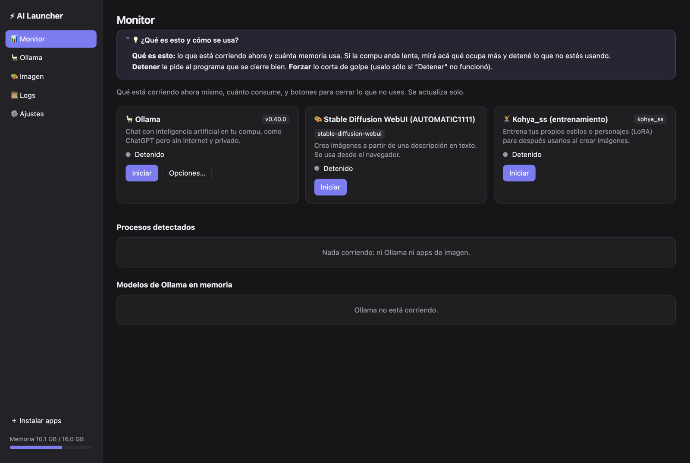

# AI Launcher

**Español** · [English](README.en.md)

**AI Launcher** es una app para macOS y Windows que te deja iniciar, vigilar y detener tus herramientas de inteligencia artificial locales (**Ollama**, **Stable Diffusion** con AUTOMATIC1111, Forge o ComfyUI, y **Kohya**) desde una ventana sencilla y desde un ícono en la barra de menú (macOS) o la bandeja del sistema (Windows). Si todavía no tenés alguna de esas herramientas, también te la instala desde cero.



## Descargar

Bajá la última versión desde **[Releases](../../releases/latest)**. No necesitás tener Python instalado.

**macOS**
1. Elegí el `.dmg` que corresponde a tu Mac: `arm64` para Apple Silicon (M1, M2, M3, M4) o `x86_64` para Intel.
2. Abrilo y arrastrá **AI Launcher** a la carpeta Aplicaciones.
3. La primera vez, **clic derecho sobre la app → Abrir → Abrir**. (La app no está firmada con un certificado de Apple, por eso macOS pide confirmación. Si igual la bloquea: Ajustes del Sistema → Privacidad y seguridad → "Abrir igualmente".)

**Windows**
1. Bajá el `.zip` (`Windows-x64`) y descomprimilo en una carpeta.
2. Ejecutá `AI Launcher.exe`.
3. Si aparece "Windows protegió su PC": **Más información → Ejecutar de todas formas**. (La app no está firmada digitalmente.)
4. En Windows 10 puede hacer falta el runtime WebView2; en Windows 11 ya viene incluido.

## Qué hace

- **Monitor:** muestra qué está corriendo, con su CPU, memoria, puertos y tiempo activo. Detecta también los procesos que no se iniciaron desde la app. Permite detenerlos (o forzar el cierre, también de sus subprocesos) y descargar de memoria modelos de Ollama o el checkpoint de SD.
- **Ollama:** todas las variables de `ollama serve`, que se leen de `ollama serve --help` de la versión instalada. Se puede iniciar con `ollama serve` o con la app oficial. También se pueden descargar, cargar, borrar y chatear con modelos.
- **Stable Diffusion:** todas las opciones de línea de comandos, que se leen del código de cada instalación (`modules/cmd_args.py` o `comfy/cli_args.py`), agrupadas y con buscador. Muestra el comando que se va a ejecutar y permite agregar argumentos extra y guardar perfiles.
- **Kohya:** detecta e inicia Kohya (entrenamiento de LoRA) como las demás herramientas.
- **Instalador de apps desde cero:** si no tenés Ollama, Stable Diffusion (A1111, Forge, ComfyUI) o Kohya, la app los descarga e instala por vos.
- **Ayudas para principiantes:** explicaciones en lenguaje simple junto a las opciones y variables más importantes.
- **Aviso de conflicto de memoria y puertos:** te avisa si lo que vas a iniciar compite por memoria con algo que ya está corriendo, o si el puerto ya está ocupado.
- **Logs** de todo lo que se inicia desde la app y de la app de Ollama.
- **Ícono de bandeja o barra de menú:** muestra el estado y da acceso a iniciar, detener, descargar modelos y cerrar procesos sin abrir la ventana. Opcionalmente arranca con la sesión.

## Instalar desde el código

Alternativa a los ejecutables: la app corre con tu propio Python (3.9 o superior) dentro de un entorno aislado.

- **macOS:** `./build_app.sh` genera `AI Launcher.app` en `/Applications`. El entorno queda en `~/Library/Application Support/AI Launcher/venv` y se recrea solo si se rompe.
- **Windows:** doble clic en `install_windows.bat` (agrega la app al menú Inicio; `install_windows.ps1 -Desktop` agrega también un acceso directo en el Escritorio). No pide permisos de administrador y, si falta Python, ofrece instalarlo con `winget`. El entorno queda en `%LOCALAPPDATA%\AI Launcher\venv`.

Para probarlo sin instalar:

```bash
python3 -m pip install -r app/requirements.txt
python3 app/launcher.py
```

## Compilar los ejecutables

Los ejecutables se arman con [PyInstaller](https://pyinstaller.org). En una máquina del sistema de destino (no se puede compilar para Windows desde macOS ni al revés):

```bash
python -m pip install -r packaging/requirements-build.txt
APP_VERSION=1.0.0 python packaging/build.py     # en Windows (PowerShell): $env:APP_VERSION="1.0.0"; python packaging/build.py
```

Genera los íconos y deja en `dist/` un `.dmg` (macOS) o un `.zip` (Windows). Para publicar una versión, creá un tag `vX.Y.Z` y subilo: el flujo `.github/workflows/release.yml` compila macOS (arm64 e Intel) y Windows, y adjunta los archivos a la Release.

Organización del código:
- `app/backend.py`: detección, procesos (con psutil) y API HTTP local.
- `app/installers.py`: instalación de Ollama, Stable Diffusion y Kohya.
- `app/platform_utils.py`: todo lo que depende del sistema operativo.
- `app/launcher.py`: ventana (pywebview) e ícono de bandeja (rumps en macOS, pystray en Windows).
- `app/ui.html`, `app/help.js`: la interfaz y sus ayudas.
- `packaging/`: especificación de PyInstaller y script de compilación.

## Cómo encuentra cada cosa (sin rutas fijas)

En cada arranque verifica las rutas guardadas en la caché (`config.json`). Si alguna ya no existe, vuelve a buscar, en este orden:

1. Procesos en ejecución: si Ollama o SD ya están corriendo, su propio ejecutable o carpeta indica dónde están instalados.
2. El `PATH` real del usuario: en macOS el del shell de login; en Windows el del registro.
3. Spotlight (macOS) o los programas registrados en Windows.
4. Recorrer la carpeta personal y, en Windows, las demás unidades.

Si arrancó desde la caché, además busca instalaciones nuevas en segundo plano.

## Privacidad

Todo es local: la interfaz sólo se sirve en `127.0.0.1` (con un token por sesión) y no hay telemetría, cuentas ni analítica. La app sólo se conecta a Internet cuando vos pedís instalar algo, y en ese caso descarga desde las fuentes oficiales de cada herramienta (por ejemplo sus repositorios o sitios oficiales).

## Licencia

[MIT](LICENSE).
